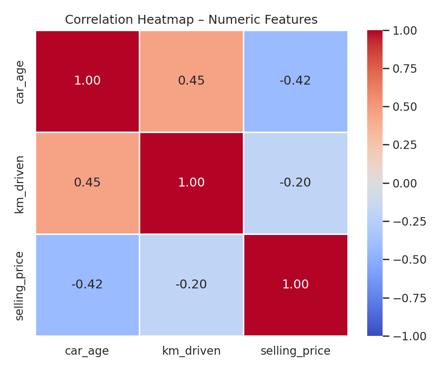
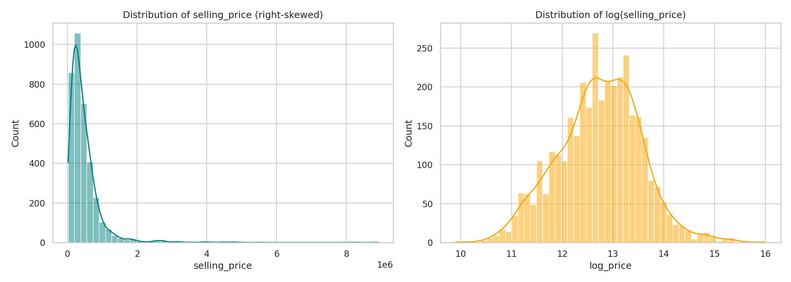
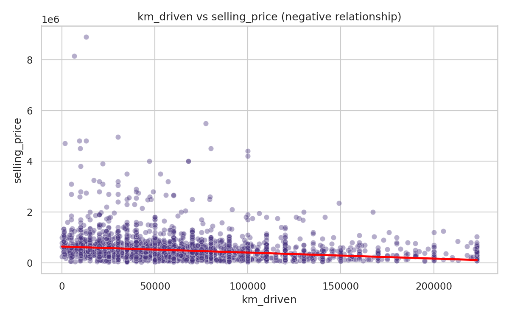
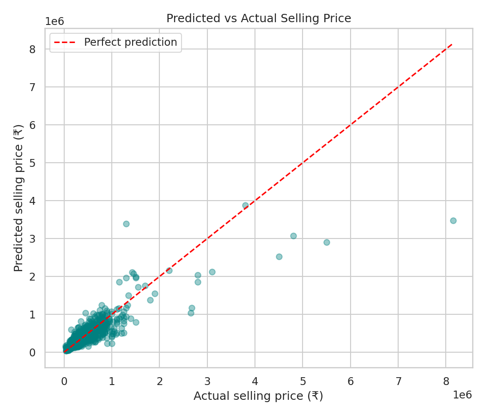

# Car Price Prediction (Linear Regression)

## Problem Statement
A used-car marketplace wants to help sellers price their vehicles fairly based on the car's age, mileage, fuel type and other listing details.

## Business Objective
Predict the resale price of a used car from its specifications so sellers get realistic price suggestions and buyers can spot overpriced listings.

## Dataset
- Vehicle Dataset from CarDekho (Kaggle - nehalbirla): https://www.kaggle.com/datasets/nehalbirla/vehicle-dataset-from-cardekho
- Rows after cleaning: 3577

## Approach
1. Data cleaning: missing values, duplicates, brand extraction, km_driven outlier capping (99th percentile)
2. Feature engineering: car_age, brand (rare brands grouped as Other), one-hot encoding, log-transform of selling_price
3. EDA: price distribution, correlation heatmap, price by fuel/transmission, km vs price scatter
4. Model: LinearRegression, 80/20 train-test split

## Additional Requirement: Correlation Analysis (before training)
Correlation between numeric features was computed before model training:

|           |   corr_with_selling_price |
|:----------|--------------------------:|
| car_age   |                    -0.424 |
| km_driven |                    -0.201 |

- car_age shows the strongest negative relationship with price (depreciation).
- km_driven is also negatively correlated (wear and tear).

## Results
| Metric | Value |
|---|---|
| R2 | 0.6992 |
| MAE | Rs 146,453 |
| RMSE | Rs 311,265 |

## Key Insights
- Newer, lower-mileage cars sell for more.
- Fuel type, transmission and brand shift the price noticeably.

## How to Run
Open `Notebook/Car_Price_Prediction.ipynb` in Google Colab and run all cells.